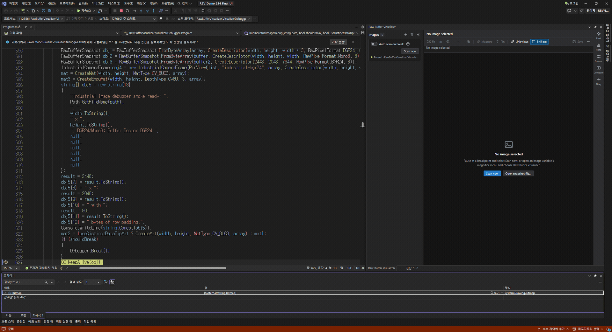
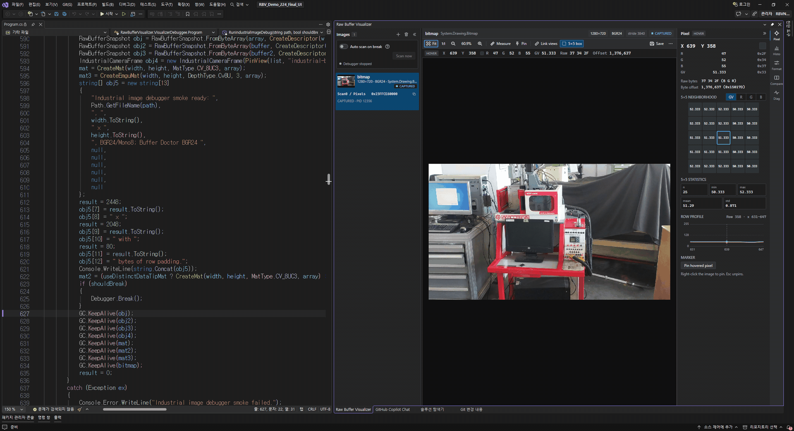
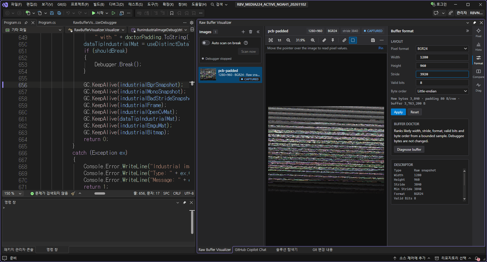
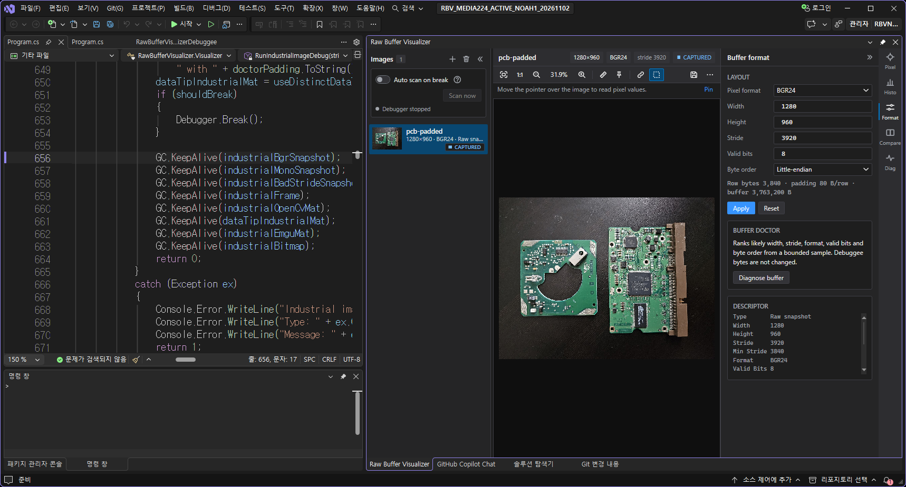

# Raw Buffer Visualizer

Image Watch-style debugging for C# machine vision: inspect image variables and raw 2D buffers at a Visual Studio breakpoint in one docked viewer.

[Visual Studio Marketplace](https://marketplace.visualstudio.com/items?itemName=openvisionlab.RawBufferVisualizer) · [Developer documentation](docs/README.md) · [Changelog](CHANGELOG.md)

## Supported Workflow

- Open Bitmap, OpenCvSharp Mat, Emgu CV Mat, RawBufferView, RawBufferSnapshot and supported collections through debugger visualizers.
- Discover initialized supported images in the paused frame with Automatic Inspector; use Connect Your Buffer for supported application-owned buffer shapes.
- Inspect dimensions, format, stride, byte order, valid bits, pixel values, source/pixel addresses and source lifetime.
- Compare retained images, diagnose buffer interpretation, inspect raw-value histograms and save snapshots.
- Use the separate WPF application for snapshots and explicit RAW layouts. It is not an additional application installed by the VSIX.

Live pointers remain tied to their original process and allocation. Continue, disposal or process exit can invalidate them; an address is not object identity. Copied snapshots have a separate lifetime. A scan can stop only after an active debugger call returns.

Supported extension targets are Visual Studio 2022 17.9+ x64 and stable Visual Studio 2026 18.x. Community, Professional and Enterprise are installation targets. The manifest owns the API range. Exact-host verification must be performed on the binary being installed.

## Source Version

Current source version: **2.2.4**. The project is version-managed; [the VSIX manifest](src/RawBufferVisualizer.VisualStudio.Vssdk/source.extension.vsixmanifest) owns the installation version. Source version is distinct from the version currently available on Marketplace.

Version 2.2.3 clears the extension's Preview label for supported Marketplace searches that exclude Preview extensions. The installation range remains VS2022 17.9+ x64.

Version 2.2.2 preserves the user-selected viewer position and tab group across image-object changes, reopening and Visual Studio layout restoration.

Version 2.2.1 corrects debugger visualizer installation-path registration and full assembly identity lookup. It retains 2.2.0's docked image opening, image-only collection routing and horizontal/vertical pixel measurement for full-resolution images.

### Recent Source History

| Version | Date | Changes |
| --- | --- | --- |
| 2.2.4 | 2026-11-02 | Inspector state persistence, layout and session recovery, compact readouts and JSON stream capacity |
| 2.2.3 | 2026-10-01 | Cleared Preview metadata while preserving the supported installation range |
| 2.2.2 | 2026-10-01 | Preserved user-selected docking, floating and document-tab placement |
| 2.2.1 | 2026-10-01 | Corrected Classic visualizer loading and package registration checks |
| 2.2.0 | 2026-09-28 | Dialog-free image opening, image-only collection routing and pixel measurement |
| 2.1.0 | 2026-09-15 | Inspection status, discovery responsiveness, pixel/histogram behavior and safer saves |
| 2.0.9 | 2026-09-12 | Checked live transfer for medium native images, final-row ROI spans and pinned-view stability |
| 2.0.8 | 2026-09-04 | Correct debugger payload packaging and bounded incremental inspection |
| 2.0.7 | 2026-09-03 | Signed Int32 image support; package superseded by 2.0.8 |
| 2.0.6 | 2026-09-03 | Version progression preserving the 2.0.5 behavior |
| 2.0.5 | 2026-09-03 | Pointer provenance, complete reads and image-array registration |

See [CHANGELOG](CHANGELOG.md) for details and older history, [English overview](docs/marketplace-overview-2.2.4.md), [Korean overview](docs/marketplace-overview-2.2.4.ko.md), and [2.2.4 change notes](docs/marketplace-release-notes-2.2.4.md).

## Build And Contribute

Follow the single [Start Here route](docs/README.md#start-here). It identifies prerequisites, the solution, the extension/debuggee startup projects and focused tests. No original developer checkout path or local binary cache is required.

The product inspects already-acquired 2D buffers. Camera control, proprietary SDK certification, PLC/I/O, recipes and 3D are outside scope. See [product contract](PRODUCT_CONCEPT.md) and [vendor policy](docs/vendor-sdk-license-policy.md).

## License

Copyright (c) 2026 Noah Choi. Source is under the [MIT License](LICENSE). Dependencies retain their own [third-party notices](THIRD-PARTY-NOTICES.md). Existing overview media uses the [documented image sources](docs/industrial-image-testing.md).
