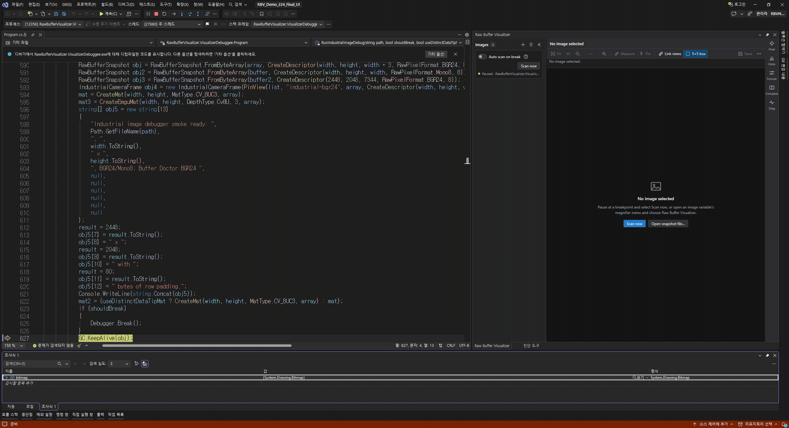
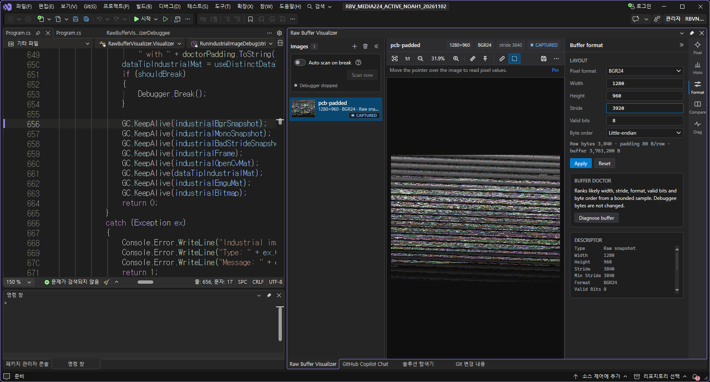
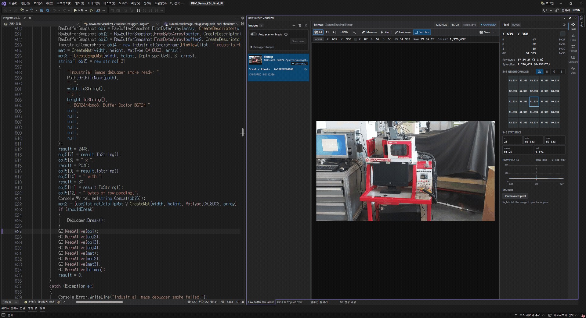
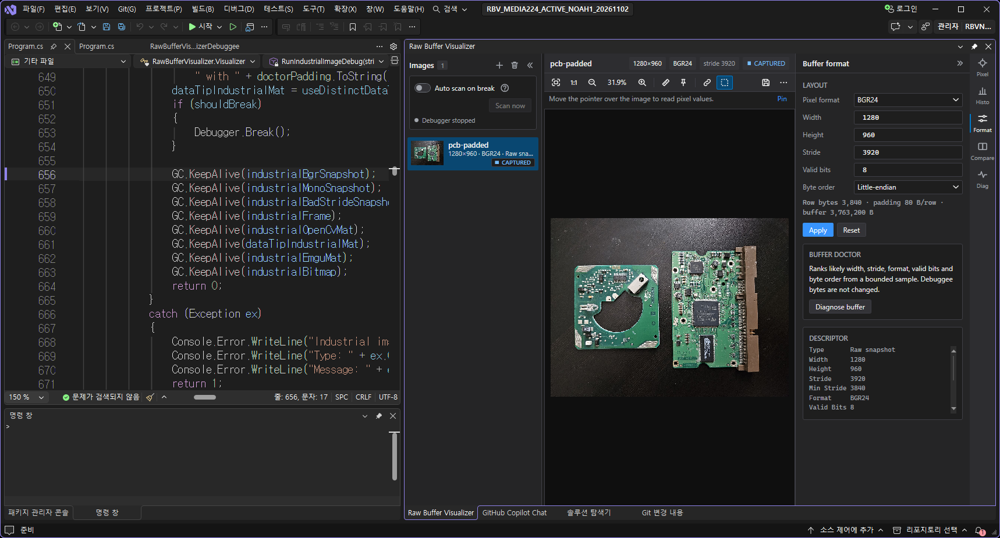

# Raw Buffer Visualizer

## Image Watch-style debugging for C# machine vision

Inspect image variables and raw 2D buffers directly inside Visual Studio at a breakpoint. Raw Buffer Visualizer opens `System.Drawing.Bitmap`, OpenCvSharp `Mat`, Emgu CV `Mat`, pointer-backed frames, snapshots, and supported collections in one docked viewer without debug-only image conversion code.

Recorded on 2026-11-03 with the final Raw Buffer Visualizer 2.2.4.0 UI in Visual Studio 2026. The first clip opens a 1280 x 720 industrial-machine image from Watch into the docked viewer. The following clips show manual stride correction in a snapshot file and pixel inspection of a captured image after execution ends. Idle intervals are removed, the zoom sequence is accelerated, and result frames are held for readability; the clips are not processing-time measurements.

## What's New In 2.2.4

- Keeps the inspector open or closed as you last chose, including after reopening and restarting Visual Studio.
- Improves narrow-panel pixel readouts, layout validation, cancelled-session handling and error-report recovery.
- Reduces temporary stream growth during JSON image transfer while keeping the existing transfer limits and timeout behavior.

## What's New In 2.2.3

- Clears the extension's Preview label so supported Visual Studio Marketplace searches can include it when Preview extensions are excluded.
- Keeps the same extension identity and VS2022 17.9+ x64 installation range. VS2022 17.8 and earlier remain unsupported.

## What's New In 2.2.2

- Keeps your chosen docked position and tab group when you open another image object.
- Preserves floating-window position and size and document-tab mode when switching images.
- Uses Visual Studio's saved layout when you reopen the viewer or restart the IDE.

Visual Studio saves editing and debugging layouts separately. Starting or ending debugging can switch to the position saved for that mode.

## What's New In 2.2.1

- Fixes debugger visualizer loading for supported single images and image collections in .NET Framework applications.
- Loads debugger components from the installed extension. No manual DLL copy to Visual Studio's global Visualizers directory is required.

## What's New In 2.2.0

- Opens supported image variables directly in the docked viewer without displaying an auxiliary Raw Buffer visualizer dialog.
- Gives Raw Buffer priority for recognized image collections while retaining the usual visualizer for non-image collections such as List<int>. The menu uses the product name without Direct or test labels.
- Adds two-point horizontal and vertical pixel measurement. Sampled previews disable measurement; full-resolution images enable it. Selecting another image clears the measurement.
- Keeps selected image rows visible, wraps long error titles, and prevents a late sampled preview from replacing an already loaded full-resolution image.
- Preserves checked live reads for large pointer-backed images and correct debugger byte forwarding. Live sources become unavailable when execution continues or the process exits; captured snapshots remain viewable.

## Main Workflow

1. Install Raw Buffer Visualizer and restart Visual Studio.
2. Start debugging and stop after the image object has been initialized.
3. Select the Raw Buffer Visualizer magnifying-glass entry on a supported variable, or open `View > Raw Buffer Visualizer` and use Automatic Inspector.
4. Select an image row to inspect its expression name, dimensions, format, stride, source state, pointer provenance, and pixels.
5. Hover the image for X/Y, channel or signed values, and raw bytes. Use Fit, 1:1, pan, zoom, markers, histogram, line profile, A/B comparison, or Save as needed.

Images accumulate in the list. **Clear all** removes the complete viewer list and resets document-specific presentation without changing data in the paused program.

## Supported Inputs

| Input | Support |
| --- | --- |
| `System.Drawing.Bitmap` | 8-bit indexed, 24-bit RGB storage, and common 32-bit RGB/ARGB/PARGB formats |
| OpenCvSharp `Mat` | `CV_8UC1`, `CV_8UC3`, `CV_8UC4`, `CV_16UC1`, `CV_32FC1`, `CV_32SC1` |
| Emgu CV `Mat` | `Cv8U` C1/C3/C4, `Cv16U` C1, `Cv32F` C1, `Cv32S` C1 |
| `RawBufferSnapshot` | Managed snapshots from byte, unsigned-16, float-32, signed-int-32, or pointer data |
| `RawBufferView` | Pointer plus explicit width, height, stride, format, length, and lifetime metadata |
| Existing application frame wrappers | Automatic Inspector recognizes safe debugger-visible layouts; ambiguous layouts can be saved once through Connect Your Buffer |
| Collections | Lists, dictionaries, concurrent dictionaries, arrays, and mixed supported image collections |
| Snapshot files | `.rbuf.json` descriptor plus `.raw` payload |

Supported pixel formats are `Mono8`, `Mono16`, `Mono10PackedLsb`, `Mono12PackedLsb`, `Binary`, `RGB24`, `BGR24`, `BGRA32`, `Float32`, `Int32`, and 8-bit Bayer `RGGB`, `GRBG`, `GBRG`, and `BGGR` previews.

`CV_32SC1` means one channel containing signed 32-bit integers. It does not mean 32 channels. Multi-channel signed formats such as `CV_32SC2`, `CV_32SC3`, and `CV_32SC4` are not interpreted as images by this release.

## Automatic Inspector And Connect Your Buffer

Leave **Auto Inspect on Break** enabled to scan the selected stack frame for initialized supported Mats and safe image-like objects. **Scan Now** remains available while automatic scanning is off. Large results use bounded discovery and incremental loading, with visible candidate, refreshed, deferred, and failed counts.

- `[Auto]` opened successfully.
- `[Map]` needs a one-time member or enum mapping.
- `[Failed]` was recognized but could not be read safely.

One failed item does not block other images. Matching automatic rows refresh in place across repeated Break, F10, and **Scan Now** operations.

When an application object is image-like but ambiguous, **Connect Your Buffer** lets you review Data, Width, Height, Stride, Buffer Length, Pixel Format, Valid Bits, and Byte Order roles. **Preview** is explicit; only **Save Mapping** persists the mapping for later equivalent breaks.

## Pointer And Lifetime Safety

The viewer validates dimensions, stride, minimum row bytes, required span, format, valid bits, and arithmetic before rendering. OpenCvSharp and Emgu rows distinguish the native object `Ptr` from the `Pixels` address used to read image bytes. ImagePtr and RawBufferView show a combined pointer/pixel address when both are identical.

Each open reads the bytes currently stored at the address. Reusing an address does not reuse stale image content. The debuggee must remain paused and keep live memory valid while the viewer reads it.

## Vision Buffer Doctor

If a raw image appears sheared, too dark, scrambled, or incorrectly packed, open `Format > Diagnose buffer`. Buffer Doctor ranks plausible dimensions, stride, format, valid bits, and byte order from bounded samples without changing the paused program's bytes.

The images below show the same snapshot file before and after manually changing its stride from 3,840 to 3,920 bytes in Format. Buffer Doctor's candidate search is bounded; this example applies a known value manually.

## Visual Studio Compatibility

- Visual Studio 2022 Community, Professional, or Enterprise `17.9+`, x64.
- Stable Visual Studio 2026 `18.x`, x64.
- Visual Studio 2019, 32-bit Visual Studio, and Preview/Insiders builds are not release targets.

Visual Studio and this extension are the only separate software required by an extension user. Image libraries used by the application being debugged remain part of that application.

## Privacy And Diagnostics

Raw Buffer Visualizer runs locally. Error rows can copy a support report containing versions, source type, technical error details, and local diagnostic paths; image payloads and credentials are excluded. Review local paths before sharing a report.

[Source code and complete documentation](https://github.com/Noah8218/RawBufferVisualizer) · [Complete changelog](https://github.com/Noah8218/RawBufferVisualizer/blob/main/CHANGELOG.md)
